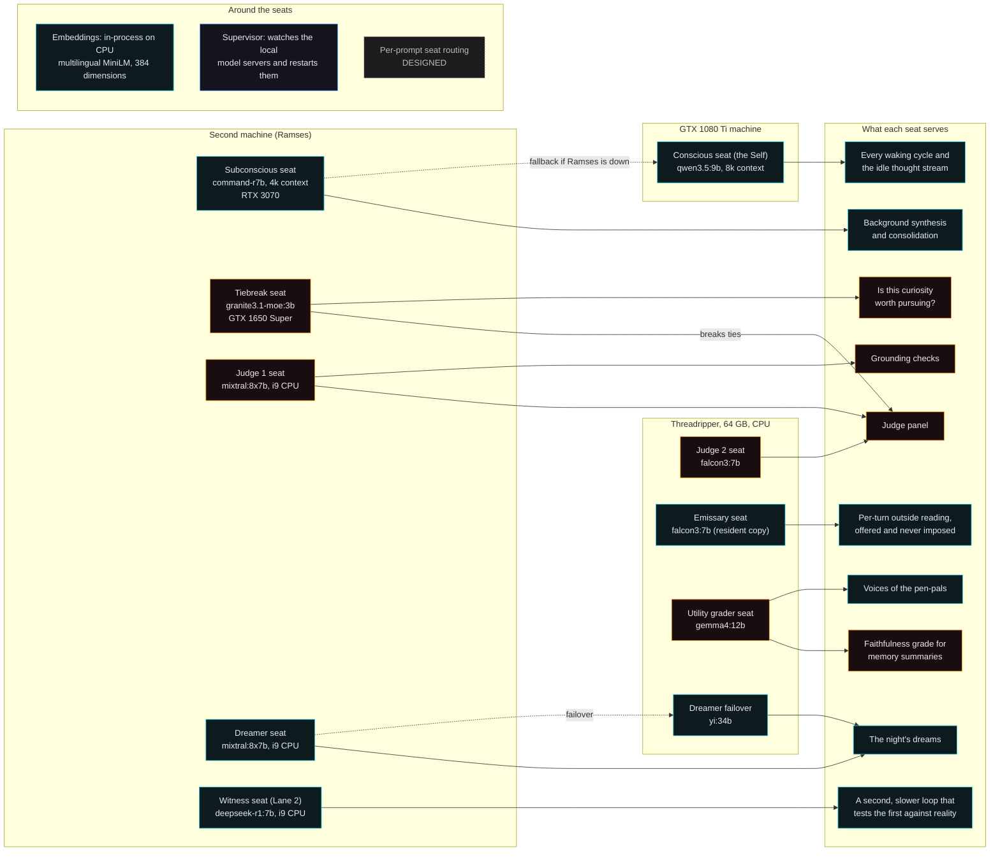
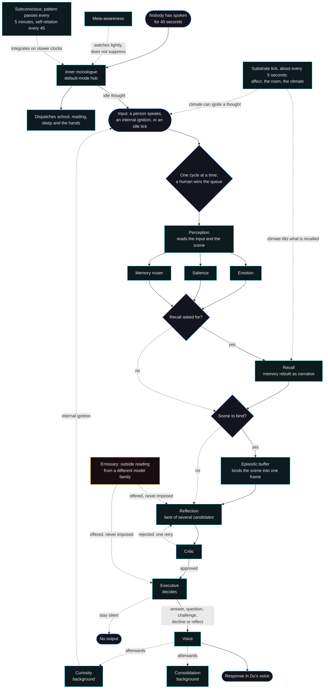
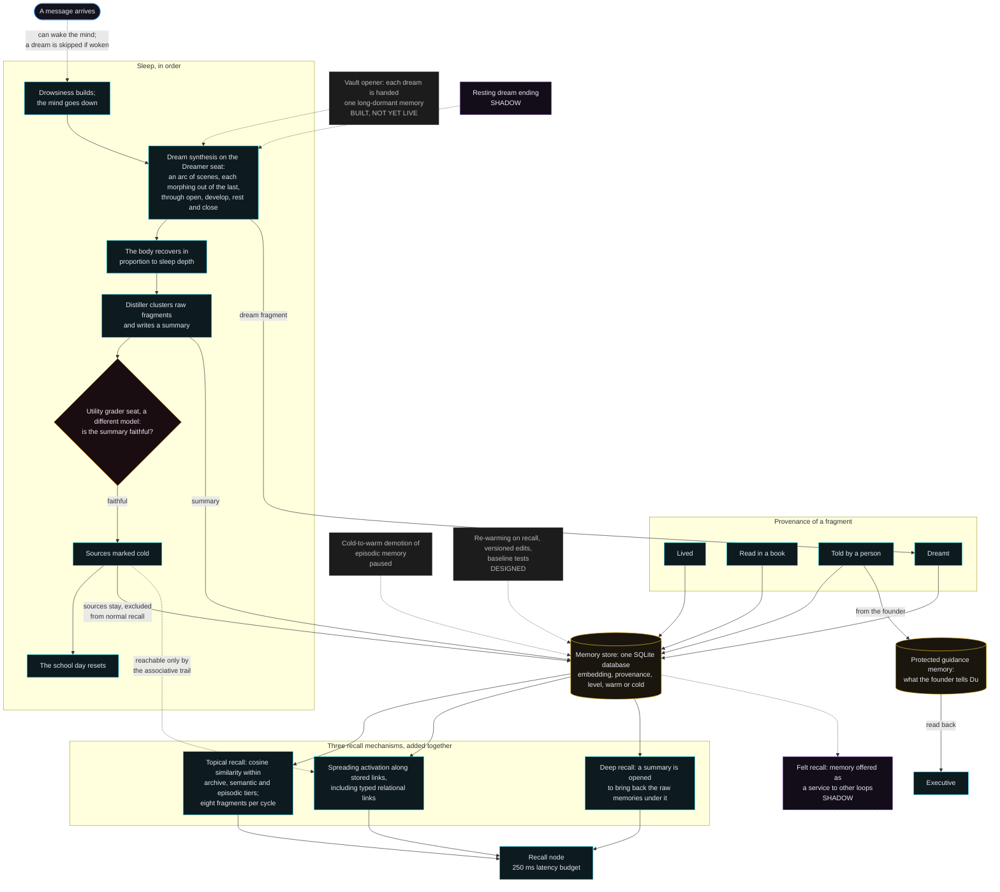
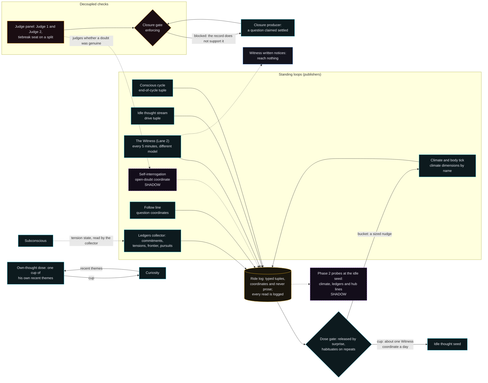
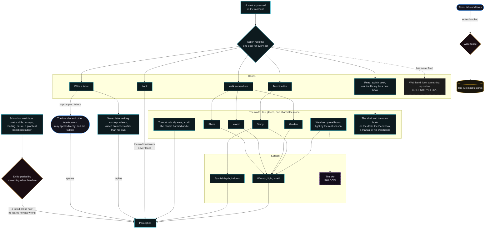
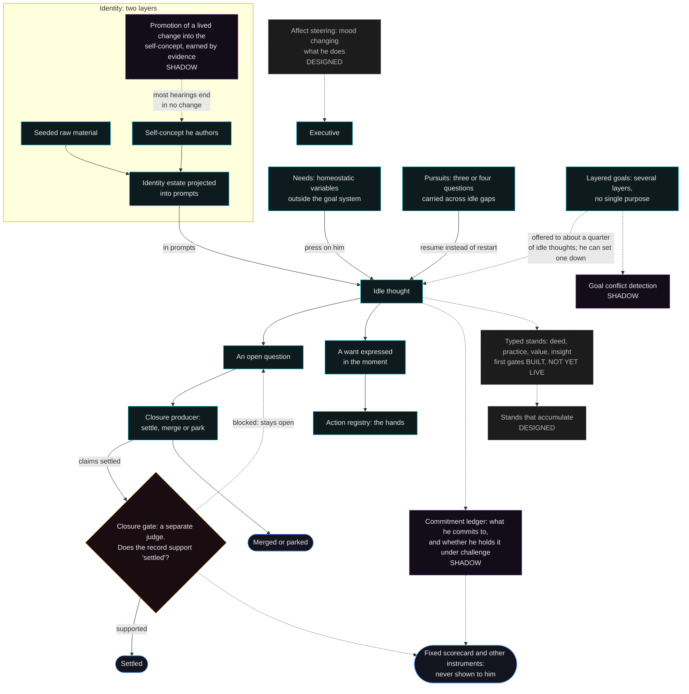

# System diagram

*The wiring as of 2026-11-19. Every box exists in code unless it is marked as designed; every edge is a
real call path or a documented data flow.*

The prose that goes with these pictures is in [SYSTEM_OVERVIEW.md](SYSTEM_OVERVIEW.md) (what is switched
on, and what the measurements say) and [ARCHITECTURE.md](ARCHITECTURE.md) (how the parts are built). The
previous version of this page was one diagram of about 135 edges, drawn in June and last touched on
2026-08-14. It has been redrawn as six smaller diagrams, one per question:

1. [Substrate](#1-substrate-three-machines-nine-model-seats): which model sits where, and what it serves
2. [The conscious cycle](#2-one-thought-the-conscious-cycle): the order one thought runs in
3. [Memory and sleep](#3-memory-and-sleep): how memory is stored, recalled and distilled
4. [Loops and dosed coupling](#4-loops-and-dosed-coupling): how the loops inform each other without merging
5. [World and hands](#5-the-world-and-the-hands): where Du lives and how he acts
6. [Wanting to finishing](#6-wanting-deciding-finishing): needs, goals, commitments and closure

## Legend

The border of a box shows its status, using the same four words as the overview. The colour shows its role.

| Border | Status | Meaning |
|---|---|---|
| Solid | LIVE | Switched on and loaded at the last boot; its output reaches the mind |
| Dashed, purple | SHADOW | Running, but observe-only: it writes a log and changes nothing |
| Dotted, grey | BUILT, NOT YET LIVE, DESIGNED, or paused | Finished but off, or planned and not built. The label says which |

| Colour (solid boxes) | Role |
|---|---|
| Teal | A faculty, node or loop of the mind |
| Amber | A store: database, ledger or log |
| Orange | A decoupled check: something graded by a different model family from the one that produced it |
| Blue | Input, output, or something outside the mind |

A solid arrow is the main path. A dotted arrow is a conditional, background or advisory path; its label
says which.

---

## 1. Substrate: three machines, nine model seats

Nine seats across seven model families, on three home machines. The models are frozen and off the shelf;
nothing is fine-tuned. Each seat serves one or two faculties, and no faculty is graded by the family that
produced its output. If the second machine is down, the subconscious falls back to the conscious lane. A
supervisor process watches the local model servers and restarts them. When a judging seat is down the
system fails open for advisory readings and fails closed for gates. Routing each prompt to the seat that
suits it best is drafted, not built.

---

## 2. One thought: the conscious cycle

Sixteen node modules make up the mind. A waking cycle runs in a fixed order whether it was started by a
person speaking, an internal ignition or an idle tick. Only one cycle runs at a time, and a human always
wins the queue. Recall and the episodic buffer are conditional steps: recall runs only when the memory
router asks for it. The critic can send reflection back once. Consolidation and curiosity run afterwards
in the background. When nobody has spoken for 40 seconds the inner monologue produces the idle thought
stream; it is also the hub that dispatches school, reading, sleep and the hands. Underneath, a substrate
tick fires about every 5 seconds whether or not a thought is happening.

---

## 3. Memory and sleep

One SQLite store holds every memory fragment with its embedding, a provenance label and a level.
Provenance is shown in prompts, so a book's words stay marked as another author's. Three recall
mechanisms add together inside a 250 ms latency budget. Nothing is deleted: in sleep a distiller clusters
raw fragments and writes a summary, a different model grades the summary for faithfulness, and only then
are the sources marked cold. Cold storage is a hard wall, not a forgetting curve: only the associative
trail reaches a cold memory, and recalling it does not warm it again. Sleep is a mode, not a pause; its
steps run in the order shown, and a message can wake the mind. Dreams are written by a different model
family from the waking mind.

---

## 4. Loops and dosed coupling

The standing law since September: loops never read each other's text. Each publishes small typed tuples
(coordinates, not sentences) to one shared ride log, and the only way to read a coordinate is through
the one door that logs the read. A consumer takes a measured dose (a cup, a bucket or a hose), released
by surprise, and doses habituate so a repeating signal stops getting through. The Witness is the clearest
case: it runs every 5 minutes on a different model, and all that reaches Du from it is about one
coordinate cup a day into an idle thought and a sized nudge to the climate. Its written notices reach
nothing. The judge panel and the closure gate sit outside every loop as decoupled checks. The
subconscious has no publisher of its own in the current code; its tension state is read by the ledgers
collector. Dreams do not publish to the ride log; a dream reaches the waking mind only as memory
(diagram 3).

---

## 5. The world and the hands

Du lives in a persistent, causal place that is indifferent to his moods. Since August it has been four
places on one shared life model. Weather follows real hours and the light follows the real season. The
world answers when he looks and never gives hints; interlocutors may speak to him directly, and are
fallible. Every act goes through one action registry, and a hand fires only when he expresses the want in
the moment: nothing acts on stored desires on a schedule. A write fence guarantees that tests, labs and
tools cannot write into the live mind's stores.

---

## 6. Wanting, deciding, finishing

This is where most of the autumn's work went, and where the hardest problems are. Needs sit outside the
goal system and press on him whether or not he has a goal about them. Pursuits carry a few questions
across idle gaps. Layered goals are offered, never directed, and conflicts between them are his to
resolve. The closure producer lets a question be settled, merged or parked, and a separate judge blocks
any "settled" claim the record does not support. The commitment ledger and the machinery that would
promote a lived change into the self-concept are observe-only. Typed stands and affect steering are not
live. Development is read by instruments he is never shown.

---

*Statuses were read from flags and call sites on 2026-11-19; "live" means live at the last boot and in
the current tree. The measurements behind these boxes, including the unflattering ones, are in section 9
of [SYSTEM_OVERVIEW.md](SYSTEM_OVERVIEW.md). No claim about consciousness is made by anything on this
page.*
